<p align="center">
  
</p>

<p align="center">
  <a href="https://www.linkedin.com/in/reamolakeng"></a>
  <a href="https://iamreamolakeng.netlify.app/"></a>
  <a href="https://iamreamolakeng.netlify.app/assests/file/Reabetsoe_Molakeng_CV.pdf"></a>
  <a href="mailto:rlenta180@gmail.com"></a>
</p>

---

## `> whoami`

```js
const reabetsoe = {
  role: "Software Engineer",
  studying: "BSc IT (Software Engineering) @ Eduvos",
  location: "Johannesburg, South Africa",
  languages: ["C#", "Java", "JavaScript", "SQL", "HTML", "CSS"],
  speaks: ["English", "Sesotho", "isiZulu"],
  traits: ["Collaborative", "Outspoken", "Gets the job done properly"],
  currentlyLearning: ["AWS & cloud fundamentals"],
  openTo: ["Internships", "Graduate roles", "Freelance work"],
};
```

I'm an outgoing developer who loves collaborating with people and is passionate about code. I like getting the job done the best way possible, and I'm bold about speaking my mind, especially on the things I care about most.

---

## `> skills --all`

<p align="center">
  
</p>

---

## `> projects --list`

<p align="center">
  
</p>

<p align="center">
  <a href="https://github.com/ReaMolakeng/Amplify"><b>View Amplify on GitHub →</b></a>
</p>

---

## `> experience`

**Lecture Assistant** · Eduvos, Bloemfontein · *Jun 2024 - Jun 2025*
- Supported students studying Information Systems Software Development.
- Assisted lecturers with preparing student exams and tests.

---

## `> education --achievements`

**BSc in Information Technology (Software Engineering)** · Eduvos · *2024 - 2026*
Software Engineering, Data Structures and Algorithms, Networking, Database Systems

**Higher Certificate in Information Systems (Software Development)** · Eduvos · *2023*
Agile and Waterfall methodologies, team management, project delivery

**Achievement:** Two-time top achiever at Eduvos Bloemfontein

---

## `> github --stats`

<p align="center">
  
  
  
</p>

<!--
Optional stats cards. These depend on a free public service that is often
overloaded. To try them, delete this line and the closing line below.

<p align="center">
  
  
</p>
-->

<p align="center">
  
</p>
